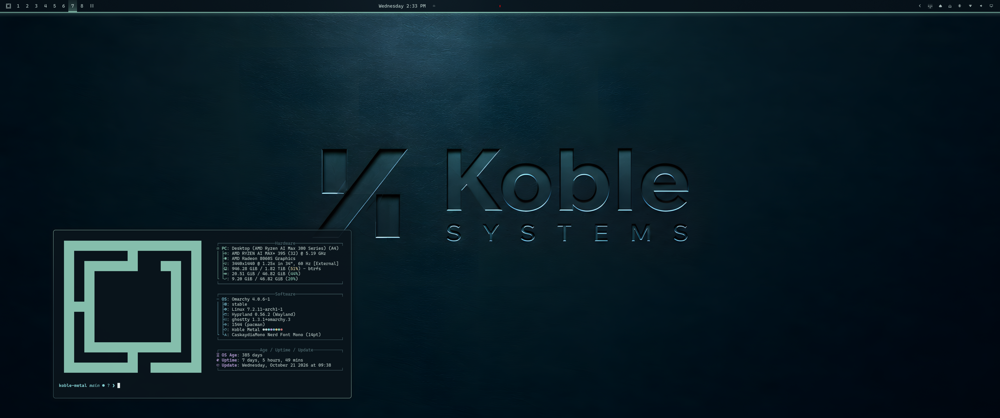

# Koble Metal — Omarchy theme

Koble-branded pressed metal theme for Omarchy.



## Install

From the Omarchy menu: **Install › Style › Theme**, then paste this repo's URL.

Or from a terminal:

```sh
omarchy theme install https://github.com/jwhear/omarchy-koble-metal-theme.git
```

Omarchy clones the repo into `~/.config/omarchy/themes/koble-metal` and applies it.
To update later, run the same command again.

## Optional extras

An Omarchy theme can only set colors, so the rest of the look ships as an opt-in step:

```sh
bash ~/.config/omarchy/themes/koble-metal/extras/install.sh
```

This installs:

- **A `theme-set` hook** that, while Koble Metal is active, sets 1px borders, 6px rounded corners, and frosted blur. It writes these to a Hyprland toggle file that loads after
  `~/.config/hypr/looknfeel.lua` and removes it when you switch themes, so your own settings come back.
- **`koble.bar-glow`**, a shell plugin that draws a glowing mint line along the bar's inner edge.
- **`koble.workspaces`**, a shell plugin that replaces the stock workspaces widget and lights the current
  workspace with a glowing block.

Both plugins only show their Koble styling while this theme is active; under other themes the glow line hides
and the workspaces widget looks like the stock one. The installer copies everything into your config, so
re-run it after updating the theme to pick up changes. To remove it all and restore the stock workspaces widget:

```sh
bash ~/.config/omarchy/themes/koble-metal/extras/uninstall.sh
```

## Notes

This theme targets current Omarchy versions that use `colors.toml` and `shell.toml`. Omarchy generates
the terminal, editor and other app theme files from `colors.toml` when the theme is applied, so the repo
ships no per-app configs.
